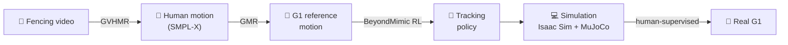

<div align="center">

# 🤺 Humanoid Combat Fencing

**Teaching a humanoid robot to fence with a saber.**

A community project from the **Humanoid Athletic Robotics Project (HARP)**

-1f6feb)


[Goals](#-goals) · [Approach](#-approach) · [Current work](#-current-work) · [Roadmap](docs/roadmap.md) · [Get involved](#-get-involved)

</div>

---

## Why fencing?

Fencing is a hard test of whole-body control. It needs:

- a **low, wide stance** held in balance
- **fast, explosive lunges** with a clean landing and recovery
- **precise arm and wrist movement** to place the blade
- and, in the end, **reacting to an opponent** in a fraction of a second

If a humanoid can fence, it can do many other athletic motions.

---

## 🎯 Goals

We work towards four goals. Each one builds on the one before it.

| | Goal | The robot can… | Status |
|:-:|---|---|:-:|
| **1** | **Footwork and saber coordination** | Advance, retreat and lunge; parry and hit; do an advance-lunge with a cut. All learned from human fencing video | 🟡 In progress |
| **2** | **Targeted hits and perception** | Hit a chosen target on a stationary dummy, and see the opponent's blade with its own camera | ⚪ Planned |
| **3** | **Footwork and bladework aimed at a target** | Close the distance and pick an attack (e.g. advance-lunge to the flank) to hit a given target | ⚪ Planned |
| **4** | **Reactive and autonomous fencing** | Parry an incoming attack in real time and, in the end, fence a short bout on its own | ⚪ Stretch |

Goal 1 **replays** motions learned from video. Goals 2–4 need the robot to **aim and react**, which takes new methods (goal-conditioned and reactive policies) and perception. Details for every goal are in the **[roadmap](docs/roadmap.md)**.

---

## 🛠 Approach

Goal 1 turns ordinary fencing video into robot motion:



| Step | Tool | What it does |
|---|---|---|
| Video → human motion | [GVHMR](https://github.com/zju3dv/GVHMR) | Estimates the fencer's 3D body pose from a single camera |
| Human → robot motion | [GMR](https://github.com/YanjieZe/GMR) | Maps that motion onto the G1's joints and proportions |
| Robot motion → policy | [BeyondMimic](https://arxiv.org/abs/2508.08241) | Trains a whole-body tracking policy with RL, using one fixed recipe for every motion |
| Simulation → hardware | Isaac Sim, MuJoCo | Each policy passes both simulators before any supervised test on the real robot |

**Our rule:** when a motion fails, we fix the **data** (foot contacts, vertical drift, segment choice) before changing the training recipe.

---

## 📍 Current work

### Goal 1 motions, easiest first

| # | Motion | What it tests |
|:-:|---|---|
| 1 | En garde | Balance in the fencing stance |
| 2 | Advance / retreat | Footwork and shifting weight |
| 3 | Extension | Precise arm movement while balanced |
| 4 | Lunge | Fast, explosive whole-body movement; the main footwork challenge |
| 5 | Parries | Precise blade positions; wrist range |
| 6 | Hits | Fast arm and wrist motion ending at a precise blade position |
| 7 | Advance-lunge with hit | Everything above in one motion |

Motions 1–4 are trained **without the saber** first. The saber is added once the grip and the sim model are settled.

### Goal 1 phases

| Phase | Description | Status |
|:-:|---|:-:|
| 1.0 | Repository setup and pinned upstream code | 🟡 Partly done |
| 1.1 | GPU environment (Isaac Sim 4.5 / Isaac Lab v2.1.0) | ⏳ Next |
| 1.2 | Train one known motion end to end to prove the pipeline | ⚪ Planned |
| 1.3 | Saber and hardware decisions (grip, wrist range, sim model) | ⚪ Planned |
| 1.4 | Fencing motion dataset: video → G1 motion | ⏳ Started |
| 1.5 | Train and evaluate all seven motions in simulation | ⚪ Planned |
| 1.6 | Human-supervised hardware tests | ⚪ Planned |

**This week:** [week plan, 9–15 Nov 2026](docs/plans/2026-11-09-week.md). Goal: the first fencing motion (en garde) working in simulation.

---

## 🚀 Getting started

```bash
git clone https://github.com/Humanoid-Athletic-Robotics-Project-HARP/Humanoid-Combat-Fencing.git
```

**Requirements for training**

- Linux with an NVIDIA GPU
- Isaac Sim 4.5 and Isaac Lab v2.1.0
- A Weights & Biases organization (for the motion registry)

Upstream projects (BeyondMimic, GMR, GVHMR) will be added as pinned git submodules in `third_party/`. Until then, follow each project's own install instructions.

---

## 📁 Repository layout

| Path | Contents |
|---|---|
| [`docs/roadmap.md`](docs/roadmap.md) | All goals and phases; Goal 1 in detail |
| [`docs/plans/`](docs/plans/) | Weekly plans |
| [`data/video_log.md`](data/video_log.md) | Links to source fencing videos (never the videos themselves) |
| `motions/` | Small retargeted G1 motion CSVs *(coming)* |
| `training/` | Run notes and W&B links, no checkpoints *(coming)* |
| `safety/checklist.md` | Checklist for human-led hardware tests *(coming)* |
| `scripts/` | Our own glue scripts *(coming)* |
| `third_party/` | Upstream code as pinned git submodules *(coming)* |

---

## 🛡 Safety

> [!IMPORTANT]
> **Nothing in this repository sends commands to a real robot.**
> Hardware tests are run by people only, with a gantry or harness, a cleared space, and **foam or padded weapons only**.

---

## 🤝 Get involved

We welcome **fencers**, **roboticists** and **ML people**.

- **Fencers:** suggest clear, single-fencer saber clips for [`data/video_log.md`](data/video_log.md). Side-on, steady camera, whole body in frame. Drills and lessons are best.
- **Roboticists:** help with the saber grip, the wrist range and the sim model (Phase 1.3).
- **ML people:** help with motion cleanup, training and evaluation (Phases 1.4–1.5).

Open an issue or a pull request to get started.

---

## 📄 License

Code and docs in this repository are **Apache-2.0** (see [LICENSE](LICENSE)). Third-party projects keep their own licenses.

> [!WARNING]
> GVHMR and the SMPL / SMPL-X body models are restricted to **non-commercial research use**.

## 🙏 Acknowledgements

This project builds on [BeyondMimic](https://arxiv.org/abs/2508.08241) (Hybrid Robotics), [GMR](https://github.com/YanjieZe/GMR) (Yanjie Ze et al.) and [GVHMR](https://github.com/zju3dv/GVHMR) (Zhejiang University 3D Vision Group).
