# Goal 1 data pipeline: interfaces

How the stages of `fencing` hand data to each other. Paths are under `HCF_DATA` (default `~/hcf-data`, see `src/fencing/paths.py`) unless they start with `REPO/`.

```mermaid
flowchart LR
    S["fencing scrape"] -->|videos/raw/ID.mp4 + manifest.jsonl| P["fencing screen / pose"]
    P -->|pose/CLIP/| R["fencing retarget"]
    R -->|retarget/csv/CLIP.csv + .json| M["fencing motion"]
    M -->|REPO/motions/NAME_vN.csv| T["fencing train"]
    T -->|runs/, eval/, policy.onnx| X["fencing sim2sim"]
```



| Stage | Owner module | Input | Output |
|---|---|---|---|
| Scrape | `fencing.scrape` | search queries | `videos/raw/<yt_id>.mp4`, `videos/manifest.jsonl`, `REPO/data/video_log.md`; with `scrape run --screen` also `videos/shortlist.json` (usable screened ranges per motion, best first); `scrape log --annotate` also reads `videos/shortlist.json`, `pose/`, `retarget/csv/` and `REPO/motions/*.json` to fill empty Start/End/View/Fencers/Hand/Notes cells and move Status off `new` (and `rejected` -> `retargeted` on a retarget output or published motion; never the other way); a `|` typed inside a cell that cannot be placed stops `scrape log` (exit 1) with the line number, nothing written |
| Screen / isolate | `fencing.pose.screen` | raw videos | `pose/<yt_id>/screen.json` (people count, chosen fencer track, quality scores, usable time ranges) + `pose/<yt_id>/track.npz` |
| Pose | `fencing.pose.cli` | video + screen.json | `pose/<clip_id>/`: `keypoints_world.npz`, `pose.json`, `overlay.png`; `gvhmr/` (GVHMR preprocessing cache, keyed on the clip, track id and a hash of the screen-track boxes, and the fencer check); GVHMR `hmr4d_results.pt` once the SMPL-X model exists |
| Retarget | `fencing.retarget.cli` | pose output | `retarget/<clip_id>.pkl` (GMR format) and `retarget/csv/<clip_id>.csv` + `<clip_id>.json` sidecar |
| Motion cleanup | `fencing.motion` | raw G1 CSV | `REPO/motions/<motion>_v<N>.csv` + provenance row in `REPO/motions/README.md` |
| Train / eval | `fencing.train` | motion CSV | `npz/<name>_mjlab.npz`, `runs/rsl_rl/...`, `eval/<run>/metrics.json`, exported ONNX |
| Sim2sim | `fencing.sim2sim` | ONNX + NPZ | `eval/<run>/sim2sim.json` (see `docs/evaluation.md`) |

## Identifiers

- **`yt_id`**: the YouTube video id.
- **`clip_id`**: `<yt_id>` for a whole video, or `<yt_id>_<start_ms>-<end_ms>` for a time range of it (milliseconds in the source video).

`fencing pose` cuts each usable range of screen.json into clips of at most `--max-seconds` (default 20 s) and names them with this `clip_id`.

## Pose output (`pose/<clip_id>/`)

| File | Content |
|---|---|
| `mediapipe_raw.npz` | MediaPipe Pose Landmarker (heavy) on the chosen fencer track: `times_s`, `image_xy` (T,33,2 px), `world` (T,33,3, hip-centred, camera axes), `visibility`, `valid`, crop boxes |
| `keypoints_world.npz` | `keypoints` (T,33,3) MediaPipe landmark order, **z up, metres, 30 fps**, floor at z = 0, root starting at x = y = 0; `times_s` (source seconds), `valid`, `visibility`, `image_xy`, `root_cam`, `fps` |
| `pose.json` | `pose_method` (`gvhmr` or `fallback_mediapipe`), `fps`, `human_height_m`, `handedness_guess`, `track_id`, source range, camera (focal, pitch, view) and `quality` (valid-frame fraction, median visibility, swaps fixed, root path, ...). A GVHMR clip adds a `gvhmr` block (fps 30, the fencer check). `handedness_guess`, `body_scale` and `quality` always come from MediaPipe on the same fencer track, also for GVHMR clips |
| `overlay.png` | Visual QA: landmarks on 8 video frames, and the lifted 3D skeleton seen from the camera side over the floor line |
| `gvhmr/fencer_check.json`, `gvhmr/fencer_check.png` | Which person GVHMR sees (see below). The PNG shows real people: it stays in `HCF_DATA`, never in the repo or `results/` |
| `gvhmr/<clip_id>/` | GVHMR's own folder: `0_input_video.mp4`, `preprocess/` (`yolo_tracks.npz`, `bbx.pt`, `fencer_boxes.npz`, `vitpose.pt`, `vit_features.pt`), later `hmr4d_results.pt` |
| `hmr4d_results.pt` | GVHMR only, copied from `gvhmr/<clip_id>/`: `smpl_params_global` and `smpl_params_incam` (SMPL-X `body_pose` (T,63), `global_orient`, `transl`, `betas` (T,10)), `K_fullimg`, at 30 fps |

The fallback lifts MediaPipe to a metric world without a body model: per-frame pinhole solve of the root from the 2D landmarks and the height-scaled world landmarks, a floor plane fitted through the lowest foot points, planted feet (still in the image) put flat on that floor, the slow part of the root depth corrected from where planted feet meet the floor, and the fast part of the horizontal root error removed by pinning planted feet in place (see `fencing.pose.root_trajectory`). `fencing.pose.joint_frames` then levels planted feet before GMR, and the retarget worker bridges short IK glitches (`despiked_joint_samples` in the sidecar's `retarget` stats).

### GVHMR branch

GVHMR runs in two phases, so the GPU work does not wait for the licence-gated files (`fencing.pose.gvhmr`, `fencing.pose.gvhmr_worker`):

| Phase | Command | Needs | Does |
|---|---|---|---|
| 1 | `scripts/hcf pose <ids> --gvhmr-preprocess` | GVHMR checkpoints only | Cuts the clip to `clips/<clip_id>.mp4` at a true 30 fps, picks the fencer's box per frame, runs ViTPose-H and HMR2 on those boxes, writes the fencer check. Cached; `pose.json` untouched |
| 2 | `scripts/hcf pose <ids>` | `body_models/smplx/SMPLX_NEUTRAL.npz` | Reuses the phase 1 cache (or makes it), runs only the GVHMR network, sets `pose_method` to `gvhmr`. A fallback clip is upgraded by this plain re-run, no `--force` needed |

**Which person.** GVHMR's demo tracks the person with the largest summed box area, which in a fencing clip can be the other fencer or the referee. The worker uses GVHMR's own demo code but writes the boxes first, so the demo's tracker never runs. Per frame it takes the YOLOv8x detection (GVHMR's detector, every frame) that overlaps the screen's fencer track most (IoU at least 0.3); the screen track is Keypoint R-CNN at 10 fps and lags a fast lunge, YOLO does not. Gaps of up to 0.5 s are bridged between YOLO boxes; longer ones use the screen track box. The same two 5-frame moving averages as GVHMR's tracker follow.

**Fencer check.** `gvhmr/fencer_check.json` compares GVHMR's ViTPose keypoints with MediaPipe's landmarks of the pipeline's fencer: the distance between the two skeletons' limb centroids, in fencer box heights. `same_person` is true when at least 90 % of frames are within 0.15. The check also fails when the chosen box is a YOLO person detection on under 50 % of frames (for example a fencer drawn in a logo, which MediaPipe and ViTPose both "find"). A clip that fails keeps the MediaPipe fallback, with the reason in `pose.json`. `gvhmr/fencer_check.png` shows six frames: chosen box green, screen track box yellow, other YOLO people red, ViTPose limbs cyan, MediaPipe landmarks magenta.

**Retarget.** `fencing retarget` reads `hmr4d_results.pt` through SMPL-X (the same `SMPLX_NEUTRAL.npz` GVHMR uses) into GMR's `get_gvhmr_data_offline_fast`, at 30 fps in and out. It does not use GMR's `load_gvhmr_pred_file`: that pads the 10 GVHMR betas to 16 but builds the model with 10, and smplx then fails on 26 shape components against 20 blend shapes. Here betas are averaged over the clip, the height for GMR's scale table is GMR's rule (1.66 m + 0.1 m × first beta, sidecar `betas_height_m`), and the z-up result is shifted so the floor is at z = 0 (a planted SMPL-X foot joint 3 cm up, like the fallback) and the pelvis starts at x = y = 0. The floor is followed frame by frame, not set once: GVHMR's global height drifts 0.14-0.49 m within a broadcast clip (sidecar `ground_drift_m`), and one floor per clip left the robot's lowest sole a median 5 cm up (more than 5 cm up in 61% of frames). The per-frame floor is the lower SMPL-X foot joint's minimum over a 1 s window, low-passed at 0.5 Hz, so a lifted foot or a flight under about 0.8 s is kept; `ground_shift_m` records the x, y shift and the median of the per-frame z shift. After it the lowest sole is a median 2.5 cm up across the 61 GVHMR clips; what remains (a few clips 5-6 cm up or 3-5 cm under the floor) comes from GMR's mapping to the robot and is re-grounded by the motion cleanup. A clip whose CSV came from another `pose_method` is retargeted again without `--force`. Whenever an existing CSV is replaced (also with `--force` or `--method`), the old CSV and sidecar are first copied to `retarget/csv/previous/<clip_id>.<old pose_method>.csv` / `.json` (`unknown` if the sidecar is missing; a later backup with the same name gets a `.1`, `.2` suffix instead of replacing the earlier one). The new sidecar's `pose_method` is the input actually used.

Both phases were run on the Goal 1 clips on 2026-11-12, once the owner had supplied `SMPLX_NEUTRAL.npz`: 61 of 64 clips have GVHMR poses (about 20 s per clip; GPU memory was not measured), 2 stay on the fallback (wrong-fencer check) and 1 (`8GwT1fx7_RM_7925-10594`) failed in MediaPipe (a pose in 43% of frames, 60% needed). All 63 clips with poses retarget; median GMR IK error over the GVHMR clips is 0.79 (fallback era: 0.9-1.4). The camera stays `static_cam=True`: on seven clips the camera pans 2.6-12.8 degrees, feeding GVHMR the measured rotation moved the path by at most 3 cm, and the static mode kept 5 of 7 paths closer to an independent reference and slid the feet less on 6 of 7, at the cost of a root 1.8-2.6 times jerkier (smoothed by the motion cleanup); study outputs are in `HCF_DATA/gvhmr_study/`. Not run: GVHMR's render videos (they need the SMPL model, not supplied), DPVO.

## Raw G1 CSV (retarget output)

Same format as `REPO/motions/`: headerless, 36 columns, `x,y,z, qx,qy,qz,qw, 29 joints`, root quaternion **xyzw**, z up, metres and radians, **30 fps**, Unitree G1 29-DoF joint order. Not normalised: the root starts wherever the pose stage put it (near the origin), heading is whatever the camera saw, and a left-handed fencer stays left-handed (`fencing motion` mirrors and re-heads). The sidecar `<clip_id>.json` holds:

```json
{
  "clip_id": "abc123_12000-19500",
  "yt_id": "abc123",
  "source_start_s": 12.0,
  "source_end_s": 19.5,
  "fps": 30,
  "pose_method": "gvhmr | fallback_<name>",
  "track_id": 1,
  "human_height_m": 1.75,
  "handedness_guess": "R | L | null",
  "notes": "...",
  "retarget": {"frames": 228, "ik_error_median": 1.3, "joint_limit_frac": 0.07, "...": "GMR stats"}
}
```

## Motion names

`en_garde`, `advance`, `retreat`, `extension`, `lunge`, `advance_lunge`, `parry_<name>`, `cut_<target>`, `thrust`, `advance_lunge_cut` (same as `REPO/motions/README.md`). Every published motion is **right-handed** (mirrored if the source fencer is left-handed), starts at the origin facing **+x**, with feet on the floor (z = 0).

"Facing +x" means the **fencing line** is world +x (`--heading line`, the default since 2026-11-09): advances travel +x, retreats -x. The pelvis of a saber en garde is turned 30-60 deg off the line, so the pelvis yaw is *not* 0; `en_garde_v1` predates this and used the start pelvis yaw (`--heading pelvis`). The line is the root travel direction when the clip travels (>= 0.3 m, mostly straight), else the back-foot -> front-foot direction.

## Video-derived motion: known errors and their fixes

| Error | Cause | Fix |
|---|---|---|
| Heading drifts with the fencer's position in the image (8VWY retreat: 1.3 m sideways, 50 deg yaw) | MediaPipe world landmarks are expressed relative to the viewing ray to the person, not the camera axes | `fencing.pose.root_trajectory.ray_rotations` rotates each frame from the hip-ray frame back to camera axes (`POSE_VERSION` 2). Hip-line yaw vs ray angle went from slope ~1 (corr 0.93) to ~0.3 |
| Remaining slow heading drift and a bent root path | Monocular depth along the camera axis | `fixes.straighten_line` (clean step `straighten`): removes the low-passed (0.5 Hz) pelvis yaw drift about the mean heading, projects the root onto the line keeping 25 % of the sideways offset. Skipped when the slow yaw range exceeds 60 deg (a real turn). `--no-straighten`, `--lateral-keep` |
| Drills labelled `lunge` | Every step widens the stance mid-step; raw feet float in and out of contact | `segment`: a foot slower than 0.15 m/s counts as planted; active intervals split at every stance-width valley (one cut per step); a lunge needs the widening led by the front foot and the back foot planted apart from at most one advance step |
| Non-fencing or wrong-person clips pass the physics checks | Tracker switches people, stretching videos | Plausibility gate in `quality.py` (fails start with `implausible:`): torso tilt > 45 deg or pelvis < 0.50 m / > 0.90 m held 0.2 s, root ground speed > 6 m/s, sidecar GMR `ik_error_median` > 3.0 or `joint_limit_frac` > 0.20. Calibrated on the Goal 1 clips: good clips tilt <= 24 deg, root <= 4 m/s, pelvis >= 0.59 m, IK 0.9-1.4, at-limit <= 5.5 %; the bad ones (rKRYHsJDnJc_18033-23467, zTzr6NhNRDg_*) fail on 2-4 counts each |
| End en garde floating 8-16 cm (lunge_v1, advance_lunge_v1) | Monocular depth sinks the held lunge, the only frames with a planted foot; the clip is cut while the feet still move, and the floor track held the sunken contact height to the end | `fixes.contact_floor_track`: before the first and after the last contact the lower foot is the floor |
| Front foot hovering 10-15 cm through a held lunge, or a foot left in the air by the end hold | Retarget over-bends the front knee (~0.4 rad); contact detection needs the sole within 3-5 cm of the floor, the slide fix pins only xy | `fixes.plant_still_feet` (clean step `plant_still_feet`, every contact round and once after the holds): a foot still for 0.3 s (2 Hz-smoothed speed < 0.35 m/s) and > 2 cm up is put on the floor at its median xy by leg IK. `CleanConfig.plant_hover_m` (None = off) |
| Front foot twisted off the line (en_garde_v1: 47 deg, right hip yaw −0.77, hip roll −0.37; COM 1.8 cm outside the support polygon) | Monocular pose estimates leg twist about the leg's own axis worst of all | `fixes.set_foot_heading` (not in `clean_motion`; applied by hand when building `en_garde_v2`): turns one foot about the vertical through its sole centre to a target heading by leg IK, the sole held in place. A static stance whose COM is outside the support polygon can't be tracked, so the policy finds its own: every `en_garde_v1`-based policy carried a ~0.28 rad right hip yaw offset |
| Wrist joints carry 0.2-0.3 rad of tracking error each, with idle motors, and more training does not help (`advance_lunge_cut_v3`: joint 0.110 at 3000 and at 6000 it) | Video pose has no wrist rotation, so the retargeted wrist pitch and yaw are an IK by-product, up to 1.2 rad from the default pose. The 5 Nm wrist motors' action scale is 0.075 rad, so those angles need actions of 7 to 16 and are never learned. (The saber task widens the scale for the sword wrist only.) | `fixes.neutralize_wrists` sets wrist pitch and yaw to 0 for arms the source did not measure: both arms on footwork clips, and the rear arm under bladework (the sword arm is keyframed). Applied in `lunge_v4`, `advance_lunge_v4` and `advance_lunge_cut_v4`. Not for mocap, where the wrists are real |
| Policy falls or drifts in the eval's post-motion hold (advance_lunge_v2: recovery 0.00; advance_lunge_cut_v2: 0.82; en_garde_v2: 0.07) | mjlab's `MotionCommand` resamples an env the moment its motion ends, so a policy only ever practises standing still for as long as the reference's end hold (0.5 s), while the eval holds the last frame for 2 s. Whether a 0.5 s-hold policy stands is luck: en_garde_v1's did and en_garde_v2's didn't | End holds at least as long as the eval's: `CleanConfig.end_hold_s` (default: `hold_s`) for cleaned clips; `motion blade --end-hold` (default 2.0 s, `BladeConfig.end_hold_s`) for bladework. Confirmed on `advance_lunge_v3` (2 s end hold, same data as v2): recovery 0.00 → 1.00, mjlab PASS and sim2sim PASS. `en_garde_v3` and the `*_v3` bladework set use 2 s. `lunge_v3` and `lunge_v4` were published with the 0.5 s hold: v3's policy happened to stand (recovery 1.00) and v4's fell (0.09). `lunge_v5` is v4 with a 2 s hold and passes (1.00) in mjlab, sim2sim and the C++ controller. Check the end hold of every new footwork clip |
| Sword arm far off the reference only at the start or end guard of a keyframed motion (`advance_lunge_cut_v4`: right wrist yaw 0.78 rad off in the first third, under 0.09 after; joint 0.132 against 0.079) | The blade keyframer solved the same guard target twice, the second time starting from the cut pose, and landed in a different arm solution (wrist yaw −1.12 rad at the start, +1.45 at the end). The policy held a pose between the two until the footwork began | `keyframes._solve_all` reuses the first solution when a blade target repeats, and re-solves from it if the stance changed. `advance_lunge_cut_v5`: guards within 0.10 rad, joint error 0.098 → 0.076. v2 and v3 had the same defect; the static `*_v3` set did not |
| Key-frame blade-tip error near the 5 cm gate on one cut while its whole-motion mean is fine (`cut_head_v3`: 4.1 cm mjlab, 4.2 sim2sim, 4.4 MTC, 6.1 PhysX; mean 2.6; the flank and chest cuts 2-3 cm) | Bladework moves are stretched only for joint *speed*. The head cut's straight-arm swing moves no joint fast (0.37x motor), so its 0.2 s request stood. But it swings the whole arm and blade as one lever: inverse dynamics of that move needs 1.94x the shoulder pitch and 5.20x the wrist pitch effort limit, where every other Goal 1 move stays at or under 2.27x. The reference tip was still 19.5 cm and 6.0 cm from its key position, at 9.9 and 4.9 m/s, at the two policy steps before the key. Both steps are in the ±2-step scoring window (flank: 2.6 / 1.0 cm at 2.3 / 0.7 m/s). In sim2sim the robot arrives short along the path at those steps (3.6 and 5.3 cm short; tip error 4.2 / 6.0 cm), with the wrist pitch at its 5 Nm limit and the shoulder pitch at 22.8 of 25 Nm. The key-frame mapping is not the cause: frame 24 at 30 fps is exactly step 40 | `cut_head` asks for 0.3 s (`recipes.STATIC_RECIPES`): the shortest 30 fps move inside the envelope of the other Goal 1 moves (0.81x shoulder pitch, 2.35x wrist pitch). At 0.267 s the wrist pitch is still at 2.95x. `cut_head_v4`: tip 6.6 cm out at 3.9 m/s two steps before the key; peak tip speed 11.6 m/s (v3: 15.4, flank 10.0). The blade summary now reports each motion's worst `max_torque_ratio` (joint and key), so the next unstretched lever move shows up before training. Same base and IK solution as v3, so only the timing changed |
| Arm inside the torso (lunge_v2 sword arm, up to 3.7 cm, the whole clip) | Oblique-front view: arm depth along the camera axis | `fixes.clear_arm_torso_collision` (not in `clean_motion`): steps one shoulder roll outward per frame until the arm is 5 mm clear of every other body, smoothed with `covering_smooth_max` so it never moves back in |
| Rear arm pinned at joint limits in every frame (lunge_v2: shoulder roll +2.23 / +2.25, the raised foil/épée rear arm; 'retarget frames at joint limits 0.14') | Source fencer's style plus retarget saturation; the G1 can't track a pose jammed against its limits | Replace the rear arm with a saber rear-arm pose (lunge_v3: `en_garde_v2`'s mean, held constant). The rear arm doesn't score in saber, so this is a deviation from the video and is recorded in the provenance |

Small fencers (under ~15 % of frame height, e.g. f2n8cbM0BcM) retarget badly (IK error 2.3-2.7, 20 %+ frames at joint limits) and fail the gate; use close static side views.

## Bladework (Phase 1.4d): keyframed saber arm

Video pose estimation cannot see wrist rotation or blade angle, so `extension`, the parries, the cuts, `thrust` and `advance_lunge_cut` get their sword arm from hand-written **blade scripts** instead of from video. Legs, root and left arm always come from a **base motion** (an en garde or an advance-lunge); only the right arm (and, when the arm alone cannot reach, waist yaw ±0.35 rad / pitch ±0.20 rad) is replaced.

| | |
|---|---|
| Module | `fencing.saber.keyframes` (IK, timing, assembly), `fencing.saber.recipes` (Goal 1 scripts, bases, publish) |
| Input | base motion CSV (`REPO/motions/en_garde_vN.csv`, `advance_lunge_vN.csv`, any cleaned CSV) or the synthetic base |
| Output | `HCF_DATA/motion/blade/<name>.csv` + `<name>.report.json` (per-key blade-tip errors, collisions, speeds, quality) + `<name>.png` with `--render`; `REPO/motions/<name>_vN.csv` with `--publish` |

```bash
scripts/hcf motion blade-list                                   # recipes + blade targets
scripts/hcf motion blade auto --script parry_quinte --render    # auto = newest published en_garde, else synthetic
scripts/hcf motion blade motions/en_garde_v3.csv --script cut_flank --publish
scripts/hcf motion blade motions/advance_lunge_v1.csv --script advance_lunge_cut --cut cut_flank [--hit-at 1.7]
scripts/hcf motion blade BASE.csv --script my_keys.json --name parry_quinte   # [{"action", "move_s", "hold_s", "at_s"}]
scripts/hcf motion blade-all --base-en-garde motions/en_garde_v3.csv --base-advance-lunge motions/advance_lunge_v3.csv --render --publish
scripts/hcf motion render HCF_DATA/motion/blade/cut_head.csv --saber --azimuth 135
```

How a script becomes a motion:

1. **Targets** are `fencing.saber.reach` `BladeTarget`s (guard offset from the right shoulder in units of arm reach, plus blade direction) and three extras: `extension`, `parry_tierce_high`, `parry_quarte_high` (waist-height tierce/quarte are out of reach, ADR 0002). Aliases: `en_garde_guard` = `en_garde`, `thrust` = `point_thrust`. Each key's target is placed on the **base motion's right shoulder at that frame**, with axes along the fencing line (world +x, `--heading x`, default) or the pelvis yaw (`--heading pelvis`), so targets follow the footwork.
2. **IK per key**: damped least squares on blade tip + blade direction (roll about the blade is free), joints inside the 0.9 soft limits, warm-started from the previous key, random restarts, collision-free solutions preferred (`reach.self_collisions`, blade capsule on). A target that repeats (back to guard) reuses the same pose if it still fits.
3. **Timing**: keys run back to back (`move_s`, then `hold_s`); a key with `at_s` lands exactly then (the cut at lunge touchdown: the first front-foot landing once the stance has widened 90 % of the way, which is not the widest stance when the back foot is dragged during the flight). Moves are minimum-jerk, stretched until every controlled joint stays under `--velocity-fraction` (0.5) × motor limit. Attacks ask for 0.2 s and get the fastest the cap allows (≈0.23–0.37 s), except `cut_head`, which asks for 0.3 s because the speed cap does not see its torque demand (known-errors table above). The summary reports `max_torque_ratio`: the worst peak inverse-dynamics torque over effort limit of any keyed move, with the body pinned (`keyframes.move_torque_ratio`).
4. **Blend**: moving into a key blends from the previous key's pose (or the base arm, before the first key or for the action `base`). The recipes start and end at the solved en garde guard.
5. **Report** (measured on the final motion): blade-tip and direction error at each key, worst drift over each hold (the body moving under a held arm), self-collision frames, soft-limit breaches and joint speed. `--publish` needs a `pass` (or `warn` with `--allow-warn`) from `fencing motion check` **and** every key within 2 cm / 5° with no collision frames. Provenance says which part is video (legs/root/left arm, or SYNTHETIC) and that the saber arm is keyframed.

Limitations: the targets are coaching-reference estimates, not measured from video; the cutting-edge orientation (roll about the blade) is not constrained; the blade path *between* keys is joint-space min-jerk, not a designed cut trajectory (it is collision-checked); a long hold on a video base drifts with the torso, which the report shows as `hold_drift_m`.

## Rebuilding every motion and policy

`motions/recipes/goal1.toml` says how each of the 17 final motions is built: the source (a retarget CSV, or another motion in the file), the clean frames and config, and every fix after it, each step one existing function (`fencing.motion.rebuild`). `fencing pipeline queue` trains and evaluates whatever is in `motions/`. From GVHMR poses to trained policies:

```bash
scripts/hcf pose IpM7citb5bs_3837-11411 GKsaQ3jsvuI_196546-206606 53FZTK_8qOI_0-20000 aY1P3wzvNBM_0-20000   # GVHMR phase 2
scripts/hcf retarget IpM7citb5bs_3837-11411 GKsaQ3jsvuI_196546-206606 53FZTK_8qOI_0-20000 aY1P3wzvNBM_0-20000
scripts/hcf motion rebuild --compare            # all 17 -> HCF_DATA/motion/rebuild/goal1/, nothing in motions/ (reads HCF_DATA/retarget/csv: GVHMR CSVs now, see "Reproduction")
#   read each motion's check line and its "tied_to_mediapipe" notes, render, edit frames in goal1.toml, repeat
scripts/hcf motion rebuild --publish            # new versions (next free _vN) in motions/, never overwrites
scripts/hcf pipeline --dry-run queue --goal1 --mtc   # the exact commands, nothing run
scripts/hcf pipeline queue --goal1 --mtc        # train, export, eval, sim2sim --video; then MTC
```

The four clips are the recipe's `clip:` sources. A clip whose CSV came from the MediaPipe fallback is retargeted again without `--force`, and the old CSV is kept in `retarget/csv/previous/`.

**What has to be chosen again.** The frame ranges (which en garde, which advance and retreat of the drill, which of the four lunges), the en garde clean config, and the fixes for MediaPipe artefacts (front-foot heading, rear arm, sword arm in the torso, wrists) were all judged on MediaPipe CSVs. Each motion's `tied_to_mediapipe` list in the recipe names them, and the rebuild prints that list for every motion whose CSV now has another `pose_method` than its `tuned_on`. Nothing is picked automatically: change the TOML by hand. The bladework and `stand_to_en_garde` take nothing from the clips themselves; they follow their base motion.

**Publishing.** `--publish` builds everything first, then goes through the motions in dependency order. A motion whose output is byte-identical to any of its versions in `motions/` is left alone (`unchanged`, naming that version), so a second `--publish` writes nothing and an old step rebuilt by mistake does not come back as the newest version (`publish_motion` refuses the same way for every caller, `motion blade-all --publish` included). Any other motion gets a new version only on a `motion check` pass (or warn where the recipe says `allow_warn`), with its blade keys within tolerance, and only if every motion it is built from was published or unchanged. The sidecar's `rebuild` record names the files it was built from and their sha256: the retarget CSV, the base motion file (new or unchanged), and for lunge's rear arm the en garde point it was taken from (the step number, its sha256 and the en garde version published with it). `--only en_garde` rebuilds one motion and what it needs; publishing a base without its dependants leaves the bladework on the old base, so rebuild them together.

**Reproduction.** The rebuild reads only `<csv dir>/<clip>.csv` (default `HCF_DATA/retarget/csv`), and that directory now holds the GVHMR retargets. The MediaPipe CSVs `goal1.toml` was written on are kept as `HCF_DATA/retarget/csv/previous/<clip>.fallback_mediapipe.{csv,json}`, and nothing reads them automatically. Stage them by hand under their plain names, then point `--csv-dir` at that folder:

```bash
mkdir -p ~/hcf-data/retarget/csv/mediapipe_goal1
for clip in IpM7citb5bs_3837-11411 GKsaQ3jsvuI_196546-206606 53FZTK_8qOI_0-20000 aY1P3wzvNBM_0-20000; do
  for ext in csv json; do
    cp ~/hcf-data/retarget/csv/previous/$clip.fallback_mediapipe.$ext ~/hcf-data/retarget/csv/mediapipe_goal1/$clip.$ext
  done
done
scripts/hcf motion rebuild --compare --csv-dir ~/hcf-data/retarget/csv/mediapipe_goal1
```

An independent review (2026-11-12) ran it staged this way. advance, retreat, advance_lunge and advance_lunge_cut are identical, lunge differs by 0.00036, and everything built on en garde differs by 0.0495-0.0628 rad: the lost en garde CSV below. Apart from that one input, the recipe is written to give byte-identical copies of the 17 published final motions and of every version it names as a checkpoint (`en_garde_v1`, `en_garde_v2`, `lunge_v2` to `lunge_v4`, `advance_lunge_v3`). After the `blade_path` change (2026-11-12) the 11 bladework motions and `stand_to_en_garde`, built with `--from-published en_garde_v3 advance_lunge_v4`, were checked again and are byte-identical to their published files. Older versions that are not on the chain (`extension_v1`, `extension_v2`, `cut_head_v3` and the like) are not rebuilt. One input is gone: `IpM7citb5bs_3837-11411.csv` was retargeted again 14 minutes after `en_garde_v1` was cut from it, and the old CSV was not kept. Everything built on en garde (lunge's rear arm, the 10 static bladework motions, `stand_to_en_garde`) moves by up to 0.063 rad in a joint (lunge by 0.0004). `scripts/hcf motion rebuild --compare --from-published en_garde_v1` starts from the published file at that point instead, and then all 17 are identical. `--from-published` never publishes.

**The queue.** At most two motions train at once (`--max-parallel 1` for one); each motion runs its whole chain in order. Task: the saber task for bladework and the plain G1 for footwork. For `stand_to_en_garde` there is no default in code. The recommended entry, by simulation only, is `Fencing-Tracking-Flat-G1-Saber-Entry-Joint05` (run tag `feetjoint05`; the Entry task plus a joint-angle reward at weight 0.5). It is the only one of the four trained variants that passes its own gates in mjlab, CPU MuJoCo, MTC and PhysX and lets all ten chained saber motions pass ([mtc.md, Paid for joint angles](mtc.md#paid-for-joint-angles-stand_to_en_garde_v1_feetjoint05-2026-11-12-recommended)). Train it with `scripts/hcf pipeline train motions/stand_to_en_garde_v1.csv --task Fencing-Tracking-Flat-G1-Saber-Entry-Joint05 --tag feetjoint05 --iterations 3000` (`pipeline train` defaults to 5000 iterations; the recommended policy is the 3000-iteration run, and the feet variant got worse at 5000), or queue it with `--entry-variant feetjoint05`. Without `--entry-variant` the queue still trains and reports the two older variants, `<motion>_tip` (saber task) and `<motion>_feet` (`Fencing-Tracking-Flat-G1-Saber-Entry`, which fails the mjlab joint gate: 0.1007 at 3000 iterations, 0.1013 at 5000; because resume accepts any tag on the same task, the queue reports whichever finished run of that task it finds, currently the 5000-iteration `feet5k` one); `--entry-variant` also takes `tip`, `feet` and `feetjoint`. `pipeline train` refuses that motion without an explicit `--task`. Other runs are named `<motion>_<tag>` (`--tag`, default `pipe`), 3000 iterations. It is resumable: a run of the same motion file (name and version, under any tag) on the same task (its `run.json`, and the same CSV sha256 where recorded) whose last checkpoint reaches `--iterations` - 1 and whose `metrics.json` and `sim2sim.json` parse with a verdict makes the motion skipped. A finished run without those is only evaluated; a run stopped early is not resumed, the motion trains again. Output goes to `HCF_DATA/logs/queue/<timestamp>/<motion>.log`, a row per motion to `docs/log.md` (unless `--no-log`), and the verdict table (mjlab, sim2sim, MTC per motion) to the screen and `verdicts.txt` / `summary.json` in the same folder. With `--mtc`, `scripts/mtc_sim2sim.sh` runs after every training has finished, one motion at a time (it is CPU-timed and invalid under load), and skips evals that already have a valid `mtc.json` (one with a verdict that is not INVALID). An MTC run that fails or comes out INVALID shows in the table and makes the queue exit 1.

**What has been run.** Neither the queue nor `--publish` has been run for real. The queue has only been dry-run (on the current runs it skips all 18 items, both entry variants included, and prints no MTC command, as every eval has a valid `mtc.json`); `--publish` has only been run twice against a temporary copy of `motions/` (the first run added the new versions, the second nothing).

**The GVHMR rebuild (2026-11-12).** `motions/recipes/goal1_gvhmr.toml` holds the same 17 motions, with every choice made again on the GVHMR CSVs (each choice is explained in the file's comments). `goal1.toml` is unchanged and still reproduces the MediaPipe-era set. `scripts/hcf motion rebuild --recipe motions/recipes/goal1_gvhmr.toml --publish` was run once for real and added `en_garde_v4`, `advance_v2`, `retreat_v2`, `lunge_v6`, `advance_lunge_v5`, `extension_v4`, `parry_{prime,seconde,tierce_high,quinte,sixte}_v4`, `cut_head_v5`, `cut_{flank,chest}_v4`, `thrust_v4`, `advance_lunge_cut_v6` and `stand_to_en_garde_v2`. Every one passes `motion check` (no warn). Their sidecars record `pose_method` gvhmr, the recipe, and the sha256 of the source CSV or base. Changed choices:
- New windows. `retreat` comes from the drill clip before retreat_v1's, where every retreat warns on torso tilt over 30°. `lunge` is the clip's 3rd lunge, not the 2nd.
- New clip for `advance_lunge`: `FbuFW5CcKkI`, a right-handed sabre fencer. Every rep of `aY1P3wzvNBM` fails the plausibility gate on GVHMR, with the pelvis at 0.47-0.49 m for at least 0.2 s.
- `en_garde` drops `set_foot_heading`.
- `lunge` drops `rear_arm_pose` and `clear_arm_torso_collision`.
- Footwork end holds are 2 s.

Numbers are in the docs/log.md row of the same date. `thrust_v4` passes every check, but its joint-space move swings the tip to 7 cm above the floor; `cut_flank_v4` dips it to 0.34 m. Both are superseded by `thrust_v5` and `cut_flank_v5`, published by a second `--publish` run (2026-11-12) after the recipe set `blade_path = "line"` on those two motions. In that run the other 15 motions came out `unchanged` ([saber.md](saber.md#bladework-keyframes-phase-14d), "Why thrust_v4 sweeps the floor"). `pipeline queue --goal1`, `pipeline train --goal1` and `pipeline all` take the newest version of each motion (`latest_versions`), so they now pick `thrust_v5`, `cut_flank_v5` and `extension_v5` (tested in `tests/test_pipeline.py`). `extension_v5` came from a third `--publish` run the same day, after `blade_path = "line"` was set on `extension`; the other 16 motions came out `unchanged`. `pipeline all` and `pipeline data --blade --publish` also regenerate the bladework first, with `motion blade-all` on the newest en garde and advance-lunge bases. `blade-all` and `blade` take each recipe's `blade_path` from `goal1_gvhmr.toml` (`--blade-path recipe`, the default; `rebuild.blade_paths`), so on `en_garde_v4` they build `thrust_v5`, `cut_flank_v5` and `extension_v5` again. Every output is then byte-identical to a published version and nothing is written. `--blade-path joint` builds the swept v4s; publishing those writes nothing either, because they match `thrust_v4`, `cut_flank_v4` and `extension_v4`. None of the three has been trained yet. `thrust_v4`, `cut_flank_v4` and `extension_v4` stay in `motions/` and are only trained when named explicitly.
