# Goal 1 data pipeline: interfaces

How the stages of `fencing` hand data to each other. Paths are under `HCF_DATA` (default `~/hcf-data`, see `src/fencing/paths.py`) unless they start with `REPO/`.

```mermaid
flowchart LR
    S["fencing scrape"] -->|videos/raw/ID.mp4 + manifest.jsonl| P["fencing screen / pose"]
    P -->|pose/CLIP/| R["fencing retarget"]
    R -->|retarget/csv/CLIP.csv + .json| M["fencing motion"]
    M -->|REPO/motions/NAME_vN.csv| T["fencing train"]
    T -->|runs/, eval/, policy.onnx| X["fencing sim2sim"]
```



| Stage | Owner module | Input | Output |
|---|---|---|---|
| Scrape | `fencing.scrape` | search queries | `videos/raw/<yt_id>.mp4`, `videos/manifest.jsonl`, `REPO/data/video_log.md`; with `scrape run --screen` also `videos/shortlist.json` (usable screened ranges per motion, best first); `scrape log --annotate` also reads `videos/shortlist.json`, `pose/`, `retarget/csv/` and `REPO/motions/*.json` to fill empty Start/End/View/Fencers/Hand/Notes cells and move Status off `new` (and `rejected` -> `retargeted` on a retarget output or published motion; never the other way); a `|` typed inside a cell that cannot be placed stops `scrape log` (exit 1) with the line number, nothing written |
| Screen / isolate | `fencing.pose.screen` | raw videos | `pose/<yt_id>/screen.json` (people count, chosen fencer track, quality scores, usable time ranges) + `pose/<yt_id>/track.npz` |
| Pose | `fencing.pose.cli` | video + screen.json | `pose/<clip_id>/`: `keypoints_world.npz`, `pose.json`, `overlay.png`; plus GVHMR `hmr4d_results.pt` if the SMPL/SMPL-X models exist |
| Retarget | `fencing.retarget.cli` | pose output | `retarget/<clip_id>.pkl` (GMR format) and `retarget/csv/<clip_id>.csv` + `<clip_id>.json` sidecar |
| Motion cleanup | `fencing.motion` | raw G1 CSV | `REPO/motions/<motion>_v<N>.csv` + provenance row in `REPO/motions/README.md` |
| Train / eval | `fencing.train` | motion CSV | `npz/<name>_mjlab.npz`, `runs/rsl_rl/...`, `eval/<run>/metrics.json`, exported ONNX |
| Sim2sim | `fencing.sim2sim` | ONNX + NPZ | `eval/<run>/sim2sim.json` (see `docs/evaluation.md`) |

## Identifiers

- **`yt_id`**: the YouTube video id.
- **`clip_id`**: `<yt_id>` for a whole video, or `<yt_id>_<start_ms>-<end_ms>` for a time range of it (milliseconds in the source video).

`fencing pose` cuts each usable range of screen.json into clips of at most `--max-seconds` (default 20 s) and names them with this `clip_id`.

## Pose output (`pose/<clip_id>/`)

| File | Content |
|---|---|
| `mediapipe_raw.npz` | MediaPipe Pose Landmarker (heavy) on the chosen fencer track: `times_s`, `image_xy` (T,33,2 px), `world` (T,33,3, hip-centred, camera axes), `visibility`, `valid`, crop boxes |
| `keypoints_world.npz` | `keypoints` (T,33,3) MediaPipe landmark order, **z up, metres, 30 fps**, floor at z = 0, root starting at x = y = 0; `times_s` (source seconds), `valid`, `visibility`, `image_xy`, `root_cam`, `fps` |
| `pose.json` | `pose_method` (`gvhmr` or `fallback_mediapipe`), `fps`, `human_height_m`, `handedness_guess`, `track_id`, source range, camera (focal, pitch, view) and `quality` (valid-frame fraction, median visibility, swaps fixed, root path, ...) |
| `overlay.png` | Visual QA: landmarks on 8 video frames, and the lifted 3D skeleton seen from the camera side over the floor line |
| `hmr4d_results.pt` | GVHMR only (needs the licence-gated body models; this branch is untested) |

The fallback lifts MediaPipe to a metric world without a body model: per-frame pinhole solve of the root from the 2D landmarks and the height-scaled world landmarks, a floor plane fitted through the lowest foot points, planted feet (still in the image) put flat on that floor, the slow part of the root depth corrected from where planted feet meet the floor, and the fast part of the horizontal root error removed by pinning planted feet in place (see `fencing.pose.root_trajectory`). `fencing.pose.joint_frames` then levels planted feet before GMR, and the retarget worker bridges short IK glitches (`despiked_joint_samples` in the sidecar's `retarget` stats).

## Raw G1 CSV (retarget output)

Same format as `REPO/motions/`: headerless, 36 columns, `x,y,z, qx,qy,qz,qw, 29 joints`, root quaternion **xyzw**, z up, metres and radians, **30 fps**, Unitree G1 29-DoF joint order. Not normalised: the root starts wherever the pose stage put it (near the origin), heading is whatever the camera saw, and a left-handed fencer stays left-handed (`fencing motion` mirrors and re-heads). The sidecar `<clip_id>.json` holds:

```json
{
  "clip_id": "abc123_12000-19500",
  "yt_id": "abc123",
  "source_start_s": 12.0,
  "source_end_s": 19.5,
  "fps": 30,
  "pose_method": "gvhmr | fallback_<name>",
  "track_id": 1,
  "human_height_m": 1.75,
  "handedness_guess": "R | L | null",
  "notes": "...",
  "retarget": {"frames": 228, "ik_error_median": 1.3, "joint_limit_frac": 0.07, "...": "GMR stats"}
}
```

## Motion names

`en_garde`, `advance`, `retreat`, `extension`, `lunge`, `advance_lunge`, `parry_<name>`, `cut_<target>`, `thrust`, `advance_lunge_cut` (same as `REPO/motions/README.md`). Every published motion is **right-handed** (mirrored if the source fencer is left-handed), starts at the origin facing **+x**, with feet on the floor (z = 0).

"Facing +x" means the **fencing line** is world +x (`--heading line`, the default since 2026-11-09): advances travel +x, retreats -x. The pelvis of a saber en garde is turned 30-60 deg off the line, so the pelvis yaw is *not* 0; `en_garde_v1` predates this and used the start pelvis yaw (`--heading pelvis`). The line is the root travel direction when the clip travels (>= 0.3 m, mostly straight), else the back-foot -> front-foot direction.

## Video-derived motion: known errors and their fixes

| Error | Cause | Fix |
|---|---|---|
| Heading drifts with the fencer's position in the image (8VWY retreat: 1.3 m sideways, 50 deg yaw) | MediaPipe world landmarks are expressed relative to the viewing ray to the person, not the camera axes | `fencing.pose.root_trajectory.ray_rotations` rotates each frame from the hip-ray frame back to camera axes (`POSE_VERSION` 2). Hip-line yaw vs ray angle went from slope ~1 (corr 0.93) to ~0.3 |
| Remaining slow heading drift and a bent root path | Monocular depth along the camera axis | `fixes.straighten_line` (clean step `straighten`): removes the low-passed (0.5 Hz) pelvis yaw drift about the mean heading, projects the root onto the line keeping 25 % of the sideways offset. Skipped when the slow yaw range exceeds 60 deg (a real turn). `--no-straighten`, `--lateral-keep` |
| Drills labelled `lunge` | Every step widens the stance mid-step; raw feet float in and out of contact | `segment`: a foot slower than 0.15 m/s counts as planted; active intervals split at every stance-width valley (one cut per step); a lunge needs the widening led by the front foot and the back foot planted apart from at most one advance step |
| Non-fencing or wrong-person clips pass the physics checks | Tracker switches people, stretching videos | Plausibility gate in `quality.py` (fails start with `implausible:`): torso tilt > 45 deg or pelvis < 0.50 m / > 0.90 m held 0.2 s, root ground speed > 6 m/s, sidecar GMR `ik_error_median` > 3.0 or `joint_limit_frac` > 0.20. Calibrated on the Goal 1 clips: good clips tilt <= 24 deg, root <= 4 m/s, pelvis >= 0.59 m, IK 0.9-1.4, at-limit <= 5.5 %; the bad ones (rKRYHsJDnJc_18033-23467, zTzr6NhNRDg_*) fail on 2-4 counts each |
| End en garde floating 8-16 cm (lunge_v1, advance_lunge_v1) | Monocular depth sinks the held lunge, the only frames with a planted foot; the clip is cut while the feet still move, and the floor track held the sunken contact height to the end | `fixes.contact_floor_track`: before the first and after the last contact the lower foot is the floor |
| Front foot hovering 10-15 cm through a held lunge, or a foot left in the air by the end hold | Retarget over-bends the front knee (~0.4 rad); contact detection needs the sole within 3-5 cm of the floor, the slide fix pins only xy | `fixes.plant_still_feet` (clean step `plant_still_feet`, every contact round and once after the holds): a foot still for 0.3 s (2 Hz-smoothed speed < 0.35 m/s) and > 2 cm up is put on the floor at its median xy by leg IK. `CleanConfig.plant_hover_m` (None = off) |
| Front foot twisted off the line (en_garde_v1: 47 deg, right hip yaw −0.77, hip roll −0.37; COM 1.8 cm outside the support polygon) | Monocular pose estimates leg twist about the leg's own axis worst of all | `fixes.set_foot_heading` (not in `clean_motion`; applied by hand when building `en_garde_v2`): turns one foot about the vertical through its sole centre to a target heading by leg IK, the sole held in place. A static stance whose COM is outside the support polygon can't be tracked, so the policy finds its own: every `en_garde_v1`-based policy carried a ~0.28 rad right hip yaw offset |
| Wrist joints carry 0.2-0.3 rad of tracking error each, with idle motors, and more training does not help (`advance_lunge_cut_v3`: joint 0.110 at 3000 and at 6000 it) | Video pose has no wrist rotation, so the retargeted wrist pitch and yaw are an IK by-product, up to 1.2 rad from the default pose. The 5 Nm wrist motors' action scale is 0.075 rad, so those angles need actions of 7 to 16 and are never learned. (The saber task widens the scale for the sword wrist only.) | `fixes.neutralize_wrists` sets wrist pitch and yaw to 0 for arms the source did not measure: both arms on footwork clips, and the rear arm under bladework (the sword arm is keyframed). Applied in `lunge_v4`, `advance_lunge_v4` and `advance_lunge_cut_v4`. Not for mocap, where the wrists are real |
| Policy falls or drifts in the eval's post-motion hold (advance_lunge_v2: recovery 0.00; advance_lunge_cut_v2: 0.82; en_garde_v2: 0.07) | mjlab's `MotionCommand` resamples an env the moment its motion ends, so a policy only ever practises standing still for as long as the reference's end hold (0.5 s), while the eval holds the last frame for 2 s. Whether a 0.5 s-hold policy stands is luck: en_garde_v1's did and en_garde_v2's didn't | End holds at least as long as the eval's: `CleanConfig.end_hold_s` (default: `hold_s`) for cleaned clips; `motion blade --end-hold` (default 2.0 s, `BladeConfig.end_hold_s`) for bladework. Confirmed on `advance_lunge_v3` (2 s end hold, same data as v2): recovery 0.00 → 1.00, mjlab PASS and sim2sim PASS. `en_garde_v3` and the `*_v3` bladework set use 2 s. `lunge_v3` and `lunge_v4` were published with the 0.5 s hold: v3's policy happened to stand (recovery 1.00) and v4's fell (0.09). `lunge_v5` is v4 with a 2 s hold and passes (1.00) in mjlab, sim2sim and the C++ controller. Check the end hold of every new footwork clip |
| Sword arm far off the reference only at the start or end guard of a keyframed motion (`advance_lunge_cut_v4`: right wrist yaw 0.78 rad off in the first third, under 0.09 after; joint 0.132 against 0.079) | The blade keyframer solved the same guard target twice, the second time starting from the cut pose, and landed in a different arm solution (wrist yaw −1.12 rad at the start, +1.45 at the end). The policy held a pose between the two until the footwork began | `keyframes._solve_all` reuses the first solution when a blade target repeats, and re-solves from it if the stance changed. `advance_lunge_cut_v5`: guards within 0.10 rad, joint error 0.098 → 0.076. v2 and v3 had the same defect; the static `*_v3` set did not |
| Arm inside the torso (lunge_v2 sword arm, up to 3.7 cm, the whole clip) | Oblique-front view: arm depth along the camera axis | `fixes.clear_arm_torso_collision` (not in `clean_motion`): steps one shoulder roll outward per frame until the arm is 5 mm clear of every other body, smoothed with `covering_smooth_max` so it never moves back in |
| Rear arm pinned at joint limits in every frame (lunge_v2: shoulder roll +2.23 / +2.25, the raised foil/épée rear arm; 'retarget frames at joint limits 0.14') | Source fencer's style plus retarget saturation; the G1 can't track a pose jammed against its limits | Replace the rear arm with a saber rear-arm pose (lunge_v3: `en_garde_v2`'s mean, held constant). The rear arm doesn't score in saber, so this is a deviation from the video and is recorded in the provenance |

Small fencers (under ~15 % of frame height, e.g. f2n8cbM0BcM) retarget badly (IK error 2.3-2.7, 20 %+ frames at joint limits) and fail the gate; use close static side views.

## Bladework (Phase 1.4d): keyframed saber arm

Video pose estimation cannot see wrist rotation or blade angle, so `extension`, the parries, the cuts, `thrust` and `advance_lunge_cut` get their sword arm from hand-written **blade scripts** instead of from video. Legs, root and left arm always come from a **base motion** (an en garde or an advance-lunge); only the right arm (and, when the arm alone cannot reach, waist yaw ±0.35 rad / pitch ±0.20 rad) is replaced.

| | |
|---|---|
| Module | `fencing.saber.keyframes` (IK, timing, assembly), `fencing.saber.recipes` (Goal 1 scripts, bases, publish) |
| Input | base motion CSV (`REPO/motions/en_garde_vN.csv`, `advance_lunge_vN.csv`, any cleaned CSV) or the synthetic base |
| Output | `HCF_DATA/motion/blade/<name>.csv` + `<name>.report.json` (per-key blade-tip errors, collisions, speeds, quality) + `<name>.png` with `--render`; `REPO/motions/<name>_vN.csv` with `--publish` |

```bash
scripts/hcf motion blade-list                                   # recipes + blade targets
scripts/hcf motion blade auto --script parry_quinte --render    # auto = newest published en_garde, else synthetic
scripts/hcf motion blade motions/en_garde_v3.csv --script cut_flank --publish
scripts/hcf motion blade motions/advance_lunge_v1.csv --script advance_lunge_cut --cut cut_flank [--hit-at 1.7]
scripts/hcf motion blade BASE.csv --script my_keys.json --name parry_quinte   # [{"action", "move_s", "hold_s", "at_s"}]
scripts/hcf motion blade-all --base-en-garde motions/en_garde_v3.csv --base-advance-lunge motions/advance_lunge_v3.csv --render --publish
scripts/hcf motion render HCF_DATA/motion/blade/cut_head.csv --saber --azimuth 135
```

How a script becomes a motion:

1. **Targets** are `fencing.saber.reach` `BladeTarget`s (guard offset from the right shoulder in units of arm reach, plus blade direction) and three extras: `extension`, `parry_tierce_high`, `parry_quarte_high` (waist-height tierce/quarte are out of reach, ADR 0002). Aliases: `en_garde_guard` = `en_garde`, `thrust` = `point_thrust`. Each key's target is placed on the **base motion's right shoulder at that frame**, with axes along the fencing line (world +x, `--heading x`, default) or the pelvis yaw (`--heading pelvis`), so targets follow the footwork.
2. **IK per key**: damped least squares on blade tip + blade direction (roll about the blade is free), joints inside the 0.9 soft limits, warm-started from the previous key, random restarts, collision-free solutions preferred (`reach.self_collisions`, blade capsule on). A target that repeats (back to guard) reuses the same pose if it still fits.
3. **Timing**: keys run back to back (`move_s`, then `hold_s`); a key with `at_s` lands exactly then (the cut at lunge touchdown: the first front-foot landing once the stance has widened 90 % of the way, which is not the widest stance when the back foot is dragged during the flight). Moves are minimum-jerk, stretched until every controlled joint stays under `--velocity-fraction` (0.5) × motor limit. Attacks ask for 0.2 s and get the fastest the cap allows (≈0.27–0.37 s).
4. **Blend**: moving into a key blends from the previous key's pose (or the base arm, before the first key or for the action `base`). The recipes start and end at the solved en garde guard.
5. **Report** (measured on the final motion): blade-tip and direction error at each key, worst drift over each hold (the body moving under a held arm), self-collision frames, soft-limit breaches and joint speed. `--publish` needs a `pass` (or `warn` with `--allow-warn`) from `fencing motion check` **and** every key within 2 cm / 5° with no collision frames. Provenance says which part is video (legs/root/left arm, or SYNTHETIC) and that the saber arm is keyframed.

Limitations: the targets are coaching-reference estimates, not measured from video; the cutting-edge orientation (roll about the blade) is not constrained; the blade path *between* keys is joint-space min-jerk, not a designed cut trajectory (it is collision-checked); a long hold on a video base drifts with the torso, which the report shows as `hold_drift_m`.
